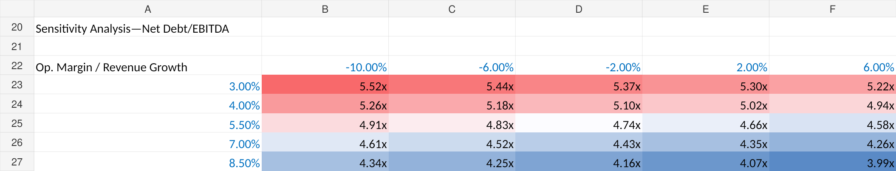

# LG Energy Solution | Corporate Financial & Credit Analysis

**Independent research project · Excel · Version 0.2.0 (October 2026)**

An Excel-based assessment of **LG Energy Solution's consolidated financial performance and credit profile** using FY2023–FY2025 audited financial statements. The workbook combines historical financial analysis, credit metrics, illustrative FY2026 base/downside scenarios, and a two-variable leverage sensitivity analysis.

> **Scope:** This release covers financial and credit analysis only. It does **not** claim to assess LG Energy Solution's bond issuance, assign a credit rating, or provide an investment recommendation.

## Key findings

1. **Leverage increased materially.** Net debt / EBITDA rose from **1.32x in 2023** to **3.72x in 2025**, as borrowings increased faster than the EBITDA proxy.
2. **Capital expenditure continued to exceed operating cash generation.** PPE-only free cash flow was negative in each historical year, including **KRW (6,401,640) million in 2025**.
3. **Operating profitability recovered in 2025, but debt-servicing capacity remained constrained.** Operating margin improved from **2.25% in 2024** to **5.69% in 2025**, while EBIT-based interest coverage reached **1.65x** in 2025 (versus 6.85x in 2023).
4. **Illustrative stress scenarios indicate further credit pressure.** Under the specified FY2026 assumptions, net debt / EBITDA reaches **4.74x (Base)** or **5.65x (Downside)**; EBIT-based interest coverage falls to **1.36x** or **0.63x**, respectively.

## Historical financial and credit metrics

All monetary figures below are in **KRW million**. Multiples are marked **x**.

| Metric | FY2023 | FY2024 | FY2025 |
|:--|--:|--:|--:|
| Revenue | 33,745,470 | 25,619,585 | 23,671,759 |
| Operating margin | 6.41% | 2.25% | 5.69% |
| EBITDA proxy | 4,450,113 | 3,621,171 | 5,037,370 |
| Operating cash flow | 4,444,179 | 5,111,700 | 4,432,277 |
| PPE-only free cash flow | (5,478,872) | (7,287,317) | (6,401,640) |
| Net debt / EBITDA | 1.32x | 3.17x | 3.72x |
| EBIT / interest expense | 6.85x | 1.02x | 1.65x |
| Current ratio | 1.57x | 1.27x | 1.10x |

The 2025 current ratio **includes KRW 3,911,334 million in assets held for sale**, so the headline ratio should not be treated as a fully unrestricted measure of liquidity.

## Illustrative FY2026 scenario analysis

**These scenarios are hypothetical stress tests, not LG Energy Solution management guidance or official earnings forecasts.** They are built from an FY2025 year-end baseline; 2026 interim results are not incorporated.

| Assumption / model output | Base case | Downside case |
|:--|--:|--:|
| Revenue growth | -2.00% | -10.00% |
| Operating margin | 5.50% | 3.00% |
| Operating cash flow margin | 18.00% | 13.00% |
| PPE capital expenditure (KRW million) | 9,000,000 | 8,500,000 |
| Incremental funding rate | 5.00% | 7.00% |
| **Free cash flow (KRW million)** | **(4,824,302)** | **(5,730,404)** |
| **Net debt / EBITDA** | **4.74x** | **5.65x** |
| **EBIT / interest expense** | **1.36x** | **0.63x** |

### Two-variable sensitivity analysis

The sensitivity grid varies **revenue growth (-10% to +6%)** and **operating margin (3.0% to 8.5%)**, holding other assumptions at the Base case settings. Implied net debt / EBITDA ranges from **3.99x to 5.52x** across the 25 combinations. The central case (**-2% revenue growth; 5.5% margin**) reconciles to the Base case at **4.74x**.

## Workbook structure

| Worksheet | Purpose |
|:--|:--|
| **Financial Statements** | FY2023–FY2025 consolidated income, balance sheet and cash flow inputs |
| **Financial Ratios** | Profitability, liquidity, leverage, operating cash flow and PPE-only FCF |
| **Credit Analysis** | EBITDA proxy, debt servicing, interest cover and liquidity metrics |
| **Scenario Analysis** | Illustrative FY2026 base/downside forecasts and leverage sensitivity grid |
| **Sources&Assumptions** | Audit report references, metric definitions, data notes and model limitations |

**[Open the Excel workbook](LGES_Corporate_Credit_Analysis_v0.2.0.xlsx)**

### Definitions and modelling limitations

- **EBIT proxy:** consolidated reported operating profit.
- **EBITDA proxy:** operating profit + depreciation + amortisation, using expenses by nature; **not** a company-reported adjusted EBITDA.
- **Net debt:** current plus non-current borrowings less cash and cash equivalents; does not include every possible debt-like obligation.
- **PPE-only free cash flow:** operating cash flow less *acquisition of property, plant and equipment*; intangible-asset investment is excluded.
- **Interest coverage:** EBIT proxy divided by reported finance interest expense, rather than a covenant-defined metric.
- **Scenario debt bridge:** free cash flow deficits are assumed to be financed by incremental debt; depreciation and amortisation are held at FY2025 levels. Incremental interest is estimated using half-year average funding at the assumed rate. The simplified model does not fully link the additional interest back into cash flow and excludes asset sales, dividends, FX effects, debt maturities and other balance-sheet changes.
- **Sensitivity:** the operating cash flow margin and PPE capex remain fixed at Base case values when revenue growth and operating margin are varied. Accordingly, this is an *illustrative* sensitivity exercise, not a fully integrated three-statement forecast.
- **FY2024 interest expense comparison:** the FY2025 audit report presents **KRW 564,246 million** for FY2024, whereas the original FY2024 report presents **KRW 564,200 million**. The **KRW 46 million** difference has not been independently reconciled. The workbook uses the FY2025 report's FY2024 comparative figure.

## Sources

Official LG Energy Solution audited consolidated financial statements:

- [FY2023 Consolidated Audit Report](https://www.lgensol.com/upload/file/audit-report/234Q_LGES_Audit_Report_CONFS_en.pdf)
- [FY2024 Consolidated Audit Report](https://www.lgensol.com/upload/file/audit-report/2024_LGES_Audit_Report_Consolidated_FS_ENG.pdf)
- [FY2025 Consolidated Audit Report](https://www.lgensol.com/upload/file/download/2025_LGES_Audit_Report_ConFS_ENG[0].pdf)

Page references to individual financial statements and notes are included in the Excel workbook. Source reports are linked rather than redistributed.

## Project status

**v0.2.0 — Financial, Credit, Scenario & Sensitivity Analysis.**

Potential future extensions include incorporating interim 2026 results, a fuller debt and interest schedule, and a separate financing-structure analysis. These are **not** part of the current completed work.

---

*This is an independent educational research project. Figures are sourced from the cited audit reports or calculated using explicitly stated assumptions. No investment advice or formal credit assessment is intended.*

*Author: Nia Lee. Excel modelling, scenario design and documentation developed with AI assistance; financial analysis and results reviewed by the author.*
